# REBUILD · Educational Village

[](modules/)
[](modules/)
[](#-pedagogical-innovations--learning-engine)
[](https://threejs.org/)
[](https://www.blender.org/)
[](exports/web/)
[-brightgreen.svg)](tests/)

> *"A storm wrecked the village of Palampur, draining it of colour and cutting it off for 5 days. Use science to bring it back."*

**REBUILD** is a story-driven, 3D browser-based STEM learning game created for Class 5–8 students in resource-constrained rural schools and their teachers. When natural disaster strikes the village of Palampur, the player steps into the shoes of a young engineer guided by village engineer **Rio**. By solving hands-on science and mathematics puzzles, players restore three critical civic lifelines: clean water, electric power, and emergency food rations. Every solved module restores vitality and floods a village landmark back with rich color.

Unlike standard educational games that reduce learning to speed, drill, and uninformative percentage scores, **REBUILD** diagnoses the *precise mental misconceptions* children hold, measures their confidence through metacognitive taps, and leverages cognitive science to turn intuitive errors into lasting conceptual understanding.

---

## 🌟 Key Features

- **Story-Driven Narrative Restoration Hook**:
  A dramatic environmental crisis anchors every lesson. Palampur begins drained of color; as students solve civic engineering challenges, landmarks visually ignite—flooding the Water Treatment Plant with vibrant **Blue**, the Solar Substation with warm **Yellow**, and the Ration Grain Store with rich **Orange**.
- **Predict-Observe-Explain (POE) Learning Engine**:
  Every puzzle enforces a strict 5-step inquiry cycle: students commit to a prediction and rate their certainty *before* touching the simulation, experience a visual counter-demonstration in real-time 3D, and codify the proven scientific principle.
- **Psychological Safety & Zero Exam Anxiety**:
  - **No countdown timers or stress clocks**, accommodating diverse reading paces and low-literacy environments.
  - Incorrect predictions are never branded "Wrong"—they are celebrated as *"Interesting Surprises!"*, fostering scientific curiosity over fear of failure.
  - Punchy, icon-supported dialogue ($\le 2$ sentences) accessible to 10-year-olds.
- **The Engineer's Notebook Progression**:
  A persistent 10-part reference notebook codified across all three modules, cataloging unlocked scientific formulas, circuit laws, and separation methods.
- **Interactive 3D Low-Poly World (Blender 5.3 $\rightarrow$ Three.js WebGL)**:
  Procedurally constructed environment optimized with Google Draco compression, sustaining 60 FPS on 10-year-old budget school laptops with integrated Intel HD graphics.
- **Flexible Low-Resource Deployment Modes**:
  - **Single-Projector / Whole-Class Broadcast**: The teacher projects the simulation onto a whitewashed wall; students predict by raising hands, driving collective classroom discourse.
  - **Shared Laptop Rotation**: Multi-student profile preservation for 2–3 shared lab computers.
  - **1:1 Student Play**: Individual exploratory learning.
- **100% Offline & Zero-Cloud Architecture**:
  Designed specifically for the 74.5% of rural schools lacking functional internet or ICT labs (UDISE+). Runs entirely locally in any modern browser without servers, cloud accounts, or recurring API dependencies.

---

## 💡 Pedagogical Innovations

```
┌────────────────────────────────────────────────────────────────────────┐
│                        THE REBUILD POE + CRI LOOP                      │
├─────────────────┬──────────────────┬─────────────────┬─────────────────┤
│  1. Rio Prompt  │  2. Prediction   │  3. Confidence  │  4. 3D Test     │
│  Context in     │  Student commits │  3-tier CRI tap │  Manipulate 3D  │
│  <= 2 sentences │  before testing  │  (Certainty)    │  simulation     │
└────────┬────────┴────────┬─────────┴────────┬────────┴────────┬────────┘
         │                 │                  │                 │
         ▼                 ▼                  ▼                 ▼
   [Disproven?] ──► "Interesting Surprise!" ──► Magnifier / Glow reveals cause
         │
         ▼
   [Proven?]    ──► Landmark floods with COLOR ──► Part unlocked in Notebook
```

### 1. Certainty of Response Index (CRI) Metacognitive Matrix
Standard quizzes cannot distinguish between a blind guess and a deep-seated misconception. REBUILD integrates Hasan et al.'s **Certainty of Response Index (CRI)** via an intuitive 3-face confidence tap (*Not Sure*, *A Bit Sure*, *Very Sure*):

| Student Performance | Low Confidence (CRI $\le 1.5$) | High Confidence (CRI $\ge 2.5$) |
|---|---|---|
| **Incorrect Prediction** | **Knowledge Gap** (Needs initial instruction) | 🚨 **Confirmed Misconception** (Durable flawed mental model; Priority 1) |
| **Correct Prediction** | **Lucky Guess** (Lacks conceptual anchoring) | 🌟 **True Conceptual Mastery** |

### 2. Hypercorrection Engine (Metcalfe et al.)
Cognitive psychology proves that when a student is **confidently wrong** and experiences an unambiguous visual refutation, the resulting "neural surprise" commands heightened attention, leading to profound and permanent conceptual updating. REBUILD intentionally guides students to test intuitive misconceptions in a safe, visual sandbox.

### 3. Actionable Teacher Enablement (From Scores to Action)
Rather than generic percentage charts, REBUILD provides teachers with a 30-second classroom diagnostic alert paired with an immediate, zero-cost physical demonstration:
> 🚨 **Class Alert:** *"11 of 28 students confidently believe clear water is safe to drink (`clear_means_safe`)."*  
> 🧪 **5-Minute Prescribed Classroom Activity:**  
> 1. Dissolve 2 teaspoons of salt in a glass of drinking water.  
> 2. Ask: *"Does this water look clean?"* (Class says yes).  
> 3. Have a student taste a drop.  
> 4. **Key Takeaway:** Optical clarity does not equal biological purity; dissolved minerals and pathogens are microscopic.

---

## 🏛️ Detailed System Architecture & Workflow

REBUILD is engineered as a **Local-First, Event-Driven, Data-Centric Client Architecture** designed specifically for zero-connectivity rural classrooms and low-spec hardware.

### High-Level System Architecture Diagram

```mermaid
flowchart TB
    subgraph Client_App ["REBUILD CLIENT APPLICATION (Browser Runtime - 100% Offline)"]

        subgraph Presentation_Layer ["1. Presentation & Rendering Layer"]
            UI["DOM Overlay UI (Vite / Vanilla TS)<br/>• Prediction Modals<br/>• 3-Face CRI Confidence Tap<br/>• 'Interesting Surprise' Banners<br/>• Engineer's Notebook Modal"]
            WebGL["3D WebGL Canvas (Three.js WebGL)<br/>• Procedural Low-Poly Village<br/>• Waypoint Follow-Cam (Rio Walker)<br/>• Baked Flat-Shading & Low Draw Calls<br/>• Dynamic Water Shaders & Landmark Recolor FX"]
        end

        subgraph Orchestration_Layer ["2. Orchestration & State Control Layer"]
            FSM["Deterministic Puzzle Engine (XState / State Machine)<br/>• Predict-Observe-Explain (POE) FSM<br/>• Strict Transition Guards<br/>• Async Module Handoff Callbacks"]
            Cinematics["Cinematic Director (Camera & Tween Engine)<br/>• Storybook Planet Orbit & Zoom<br/>• Road Ribbon & Arched Bridge Deck Tracking<br/>• Landmark Arrival Transitions"]
        end

        subgraph Simulation_Layer ["3. Domain Simulation Modules"]
            WaterMod["Clean Water (Chemistry & Health)<br/>• Gravity Settling Basin Sim<br/>• 5-Layer Graded Filter Column Stack<br/>• Pathogen Magnifier Raycaster<br/>• Thermal Disinfection Boiling Trigger"]
            PowerMod["Power for Palampur (Physics & Circuits)<br/>• Circuit Loop Continuity Graph<br/>• Bidirectional In==Out Ammeters<br/>• Conductor / Insulator Classifier"]
            RationMod["Fair Rations (Mathematics & Fractions)<br/>• Two-Pan Fraction Balance<br/>• Variable Allocator (r × d = S)<br/>• 5-Day Emergency Stock Budgeter"]
        end

        subgraph Diagnostic_Layer ["4. Metacognitive Diagnostic Layer"]
            CRICalc["Certainty of Response Index Engine<br/>• 4-Quadrant Metacognitive Evaluator<br/>• Guess vs Entrenched Misconception Filter"]
            EventLog["Misconception Event Dispatcher<br/>• Structured Event Logging<br/>• Tracks: puzzle_id, option, CRI, timestamp"]
            TeacherEngine["Teacher Remediation Engine<br/>• 30-Sec Aggregated Class Diagnosis<br/>• Maps Top Misconception to 5-Min Physical Demo"]
        end

        subgraph Storage_Layer ["5. Local Persistence & Offline Sync"]
            StateStore["Reactive Local Store<br/>• Active Student Profile<br/>• Unlocked Notebook Laws<br/>• Restored Landmark States"]
            LocalStorage[("Browser LocalStorage Engine<br/>• Key: rebuild.notebook.v1<br/>• Append-Only Event Stream<br/>• Zero Cloud Dependency")]
            SyncEngine["Air-Gapped Offline Sync Subsystem<br/>• High-Density On-Screen QR Code Generator<br/>• Offline P2P Smartphone Teacher Scanning"]
        end

        subgraph Config_Layer ["6. Schema & Localization Layer"]
            PuzzleSchema["Data-Driven Puzzle Schema (JSON)<br/>• Prompts, Validations & Distractors<br/>• Direct Misconception Mapping"]
            StringTable["Decoupled String Tables (JSON)<br/>• Class 2 English Vocabulary<br/>• Drop-In Hindi / Regional Translations"]
        end

    end

    %% Layer Wiring Connections
    UI <--> FSM
    WebGL <--> FSM
    FSM --> Cinematics
    FSM --> Simulation_Layer
    Simulation_Layer --> WebGL
    Simulation_Layer --> EventLog

    EventLog --> StateStore
    StateStore <--> LocalStorage
    LocalStorage --> CRICalc
    CRICalc --> TeacherEngine
    TeacherEngine --> UI

    PuzzleSchema --> FSM
    StringTable --> UI
    LocalStorage --> SyncEngine
```



---

### Subsystem Architecture & Responsibilities

#### 1. Presentation & Rendering Engine
* **Technology**: Three.js WebGL + HTML5 Semantic Overlay Canvas.
* **Responsibilities**:
  - Renders the interactive 3D village of Palampur (river, waterwheel, electric room, ration store, bridges, farmlands, houses).
  - Executes **grey-to-colour reveal transitions**: Palampur starts desaturated; completing modules triggers custom vertex/material recolor transitions, flooding landmarks with saturated blue, yellow, and orange hues.
  - Interactive 3D raycasting allows students to tap buildings, water valves, switches, and grain scales.
* **Hardware Budget**: Capped pixel ratio, single shared WebGL context, geometry merging (`BufferGeometryUtils`), instanced meshes for vegetation, untextured low-poly flat shading, and zero dynamic shadow casting to guarantee **solid 60 FPS on 10-year-old Intel HD Graphics 4000/520 laptops**.

#### 2. The Deterministic Orchestrator (State Machine)
* **Technology**: Finite State Machine (FSM) architecture.
* **Responsibilities**:
  - Governs the **Predict-Observe-Explain (POE)** game loop with strict transition guards.
  - Prevents students from interacting with the 3D apparatus until they have formally committed to a prediction and confidence level.
  - Handles module navigation, URL state, and inter-frame message handoffs (`onDone` callbacks).

#### State Machine Transition Map:
```
[VILLAGE OVERVIEW / ORBIT]
          │
          ▼ (Tap Building / Select Chapter)
[RIO ENTERS VILLAGE & WALKS ROAD RIBBON]
          │
          ▼ (Arrives at Landmark Entrance)
[CAMERA TRANSITION TO LAB WORKSTATION]
          │
          ▼ (Rio Dialogue Displayed: <= 2 Lines)
[PREDICTION STATE] ───(Option Selected)───► [CONFIDENCE RATING (CRI)]
                                                      │
                                                      ▼ (Not Sure / A Bit Sure / Very Sure)
                                            [INTERACTIVE 3D SIMULATION]
                                                      │
                         ┌────────────────────────────┴────────────────────────────┐
                         ▼ (Prediction Disproven)                                  ▼ (Prediction Validated)
               [OBSERVE FAILURE]                                         [OBSERVE SUCCESS]
         • Causal component glows red in 3D                        • Landmark floods with vibrant COLOR
         • "Interesting Surprise!" feedback banner                 • Unlocks Concept Card in Notebook
         • Metacognitive cognitive shift activated                 • Saves progression to localStorage
         • Log Confirmed Misconception                             • Log Concept Mastered Event
                         │                                                         │
                         ▼                                                         ▼
               [RE-TEST SIMULATION]                                      [RETURN TO VILLAGE ROAD]
```

#### 3. Domain Simulation Modules
* **Clean Water Module (`water-purification.html`)**:
  - Simulates gravitational particle sedimentation over time.
  - Drag-and-drop raycast stacking for the 5-layer filtration cylinder (coarse gravel, sand, charcoal, cloth).
  - Microscopic examination viewport rendering 2D procedural pathogen sprites in optically clear water.
  - Heat exchange physics for thermal sterilization boiling at $100^\circ\text{C}$.
* **Power & Energy Module (`power-palampur.html`)**:
  - Graph-based circuit netlist tracking continuous closed current paths.
  - Synchronized dual ammeter nodes demonstrating current conservation ($I_{\text{in}} = I_{\text{out}}$).
  - Contact gap resistance testing classifying conductors (copper, iron) vs. insulators (wood, plastic).
* **Fair Rations Module (`rationing-palampur.html`)**:
  - Real-time two-pan balance scale displaying mass equivalence and fraction proportions ($\frac{1}{4}$ vs. $\frac{1}{8}$).
  - Algebraic variable allocation modeling unknown family requirements ($r \times d = S$).
  - 5-day constraint-satisfaction grain ledger.

#### 4. Metacognitive Diagnostic & Teacher Action Subsystem
* **CRI Engine**: Evaluates prediction accuracy against the 3-face certainty tap, categorizing student responses into Knowledge Gaps (Priority 2), Lucky Guesses, or Confirmed Misconceptions (Priority 1).
* **Teacher Remediation Engine**: Aggregates class event logs and translates statistical error frequencies into immediate 5-minute zero-cost physical demonstrations.
* **Air-Gapped QR Code Sync**: For completely offline multi-laptop classrooms, student machines compress session diagnostic logs into an on-screen QR code; the teacher scans it with their phone camera to compile an instant class report without internet, Bluetooth, or cables.

#### 5. Data & Hardware Performance Budget

| Constraint | Architecture Enforcement | Performance Metric |
|---|---|---|
| **GPU Draw Calls** | Geometry merging (`BufferGeometryUtils`) & untextured materials | $< 30$ calls per frame |
| **Polygon Budget** | Low-poly procedural modeling with zero subdivision surfaces | $< 35,000$ triangles per scene |
| **Texture Memory** | Procedural vertex colors and mathematical noise patterns | $\approx 0\text{ MB}$ texture VRAM |
| **Storage Footprint** | Local-first JSON event stream stored in browser `localStorage` | $< 250\text{ KB}$ per session |
| **Runtime Target** | Single lightweight WebGL context capped at device pixel ratio 1.5 | **60 FPS** on 2016 Intel HD Graphics |

---

## 🔬 Learning Modules & Educational Puzzles

All modules map directly to the **NCERT Class 6 Curiosity Science and Mathematics** curricula (Separation of Substances, Electricity & Circuits, Fractions & Algebraic Thinking).

```
┌─────────────────────────┐
│       index.html        │  Storybook 3D rotating village planet
│  (Village Planet Hero)  │  Click / Tap to begin Rio's journey
└───────────┬─────────────┘
            │
            ▼
┌─────────────────────────┐
│    preview/index.html   │  Real-time 3D village with follow-cam
│ (Rio's Village Journey) │  Rio walks the roads, bridges & approaches
└───────────┬─────────────┘
            │
            ├──► Chapter 1: Water Treatment Plant ──► modules/water-purification.html
            ├──► Chapter 2: Electricity Room     ──► modules/power-palampur.html
            └──► Chapter 3: Ration Shop          ──► modules/rationing-palampur.html
                        │
                        ▼
            ┌───────────────────────┐
            │  Engineer's Notebook  │ (10 unlockable theory parts
            │   (Shared Progress)   │  persisted across all modules)
            └───────────────────────┘
```

### Module 1: Clean Water — Water Treatment Plant
* **Curriculum Focus**: NCERT Class 6 Science — *Separation of Substances & Water Purification*
* **Narrative Goal**: Floodwaters have contaminated Palampur's drinking supply with suspended mud, debris, and invisible pathogens. Rio and the player must purify raw river water into certified potable drinking water.
* **Tracked Misconceptions**:
  - `clear_means_safe`: Believing that if water looks transparent, it is completely safe to drink.
  - `filtering_kills_germs`: Believing physical mesh/carbon filters destroy biological bacteria and viruses.
* **Step-by-Step Educational Puzzles**:
  1. **Sedimentation & Gravitational Settling**:
     - *Task*: Students observe turbid, muddy storm water in a settling basin.
     - *Science*: Suspended particles have higher density than water. Leaving the mixture undisturbed allows insoluble silt and gravel to settle at the bottom under gravity.
  2. **Decantation Transfer**:
     - *Task*: Carefully tilt the container to transfer clarified surface water without disturbing the heavy bottom sediment.
     - *Science*: Separates liquid from settled solid phase by gentle pouring.
  3. **Multi-Stage Physical Filtration Column**:
     - *Task*: Construct a 5-layer filtration cylinder by dragging materials into their correct mechanical sequence: coarse gravel at top, coarse sand, fine sand, activated charcoal, and porous cloth at base.
     - *Science*: Particle size exclusion. Charcoal adsorbs odors and dissolved organic toxins, while graded sand strata physically trap fine suspended particles.
  4. **The Optical Clarity Paradox & Microscopic Examination**:
     - *Task*: The filtered water exits sparkling clear. The student is asked: *"Is this water safe for the village children to drink?"*
     - *The Hypercorrection Moment*: Most students predict *"Yes"* with High Confidence (CRI 3). Tapping the interactive 3D magnifier reveals live bacterial microbes swimming in the clear sample! The screen triggers an *"Interesting Surprise!"*, shattering the `clear_means_safe` intuition.
  5. **Thermal Disinfection (Boiling)**:
     - *Task*: Stoke the boiler fire to maintain $100^\circ\text{C}$ for sustained sterilization.
     - *Science*: Thermal pasteurization denatures microbial proteins and ruptures cell membranes, killing invisible pathogens.
  * **Visual Payoff**: The Water Treatment Plant floods with brilliant **Blue**, restoring clean water to every tap in Palampur.

---

### Module 2: Power for Palampur — Electricity Room & Solar Substation
* **Curriculum Focus**: NCERT Class 6 Science — *Electricity and Circuits*
* **Narrative Goal**: Downed power lines and short circuits cut off the emergency medical dispensary. Students must rewire solar generation panels, install circuit protections, and route current to refrigeration and lights.
* **Tracked Misconceptions**:
  - `one_wire_enough`: Belief that electricity flows from a source like water from a pipe, requiring only a single connecting line.
  - `current_consumed` ("Sink Model"): Intuition that electrical current is "eaten up" or partially diminished as it passes through a load (e.g. light bulb).
  - `any_solid_conducts`: Assuming all rigid solid materials conduct electrical charge.
* **Step-by-Step Educational Puzzles**:
  1. **Complete Closed Circuit Assembly**:
     - *Task*: Wire a battery and solar inverter to the clinic's lamp. Attempting a single-wire hookup fails to illuminate the bulb.
     - *Science*: Charge carriers require an unbroken, continuous closed loop from the positive terminal through the load and back to the negative terminal to maintain a potential difference.
  2. **Current Conservation & Dual Ammeter Demonstration**:
     - *Task*: Place ammeters on both the *incoming* wire and the *outgoing* wire of a shining incandescent bulb.
     - *Science*: Both ammeters read identical values ($I_{\text{in}} = I_{\text{out}}$). Current is the continuous flow of charges (Coulombs per second), not a consumable substance. Energy is transferred; charges are conserved.
  3. **Conductivity & Material Property Classification**:
     - *Task*: Test everyday village items across an open circuit terminal gap: copper wire, iron nail, wooden twig, plastic comb, graphite pencil core, rubber strip, and water.
     - *Science*: Categorizes materials into electrical conductors (delocalized mobile electrons) and insulators (tightly bound valence electrons).
  * **Visual Payoff**: The Solar Substation illuminates with warm, radiant **Yellow**, powering up the medical clinic and village streetlights.

---

### Module 3: Fair Rations — Ration Shop
* **Curriculum Focus**: NCERT Class 6 Mathematics — *Fractions, Ratios, and Introduction to Algebra*
* **Narrative Goal**: Roads are blocked for 5 days. Village grain stocks (rice, dal, wheat) must be cataloged and fairly distributed among households of different sizes without shortage or hoarding.
* **Tracked Misconceptions**:
  - `bigger_denominator_bigger` (*Whole-Number Bias*): Intuitive belief that since 8 is bigger than 4, $\frac{1}{8}$ of a sack must be larger than $\frac{1}{4}$.
  - `linear_partition_error`: Attempting to partition discrete resources without accounting for proportional family needs.
* **Step-by-Step Educational Puzzles**:
  1. **Visual Fraction Partition & Balance Scale**:
     - *Task*: Divide grain sacks into equal fourths and eighths on a two-pan balance scale.
     - *Science*: Concrete visual fractions. Cutting a unit into more partitions ($8$) yields smaller individual slices ($\frac{1}{8} < \frac{1}{4}$), dismantling the whole-number bias through tangible geometric mass.
  2. **Algebraic Unknowns in Practical Context**:
     - *Task*: Introduce placeholder variables ($r \times d = S$) to calculate total daily requirements ($r$) across days ($d$) against available stockpile ($S$).
     - *Science*: Demystifies algebra by connecting symbolic letters to physical sacks of food, illustrating that a variable simply represents an unknown quantity.
  3. **Multi-Day Dynamic Resource Budgeting**:
     - *Task*: Balance rations across a 5-day emergency schedule to ensure balanced caloric distribution for elderly, children, and workers.
     - *Science*: Proportional reasoning, linear equations, and multi-step constraint satisfaction.
  * **Visual Payoff**: The Ration Shop glows in rich, festive **Orange**, securing nourishment for all Palampur residents.

---

### 📓 The Engineer's Notebook
Across all three modules, players compile a shared 10-part reference notebook:

| # | Chapter | Part ID | Concept Title | Scientific Law / Principle Codified |
|:---:|---|---|---|---|
| **1** | Clean Water | `water.sedimentation` | Sedimentation | Insoluble heavy solids settle under gravity in undisturbed liquid |
| **2** | Clean Water | `water.decantation` | Decantation | Liquid poured off without disturbing settled lower sediment |
| **3** | Clean Water | `water.filtration` | Filtration | Graded physical strata trap particles by size exclusion; carbon absorbs toxins |
| **4** | Clean Water | `water.boiling` | Boiling | Sustained $100^\circ\text{C}$ thermal energy kills invisible pathogenic bacteria |
| **5** | Power for Palampur | `power.circuit` | A Complete Circuit | Electric charges require an unbroken, closed loop to flow |
| **6** | Power for Palampur | `power.current` | Current is Not Used Up | Charge is conserved: current entering a component equals current exiting |
| **7** | Power for Palampur | `power.conductors` | Conductors & Insulators | Metals allow free electron drift; plastics and dry wood restrict current |
| **8** | Fair Rations | `ration.variable` | A Letter Stands for a Number | A variable represents an unknown numerical value in an equality |
| **9** | Fair Rations | `ration.fractions` | More Pieces, Smaller Parts | Increasing denominator subdivides the whole into smaller fractional parts |
| **10** | Fair Rations | `ration.equation` | An Equation Plans a Resource | Balancing two sides of an equation ensures zero waste in resource planning |

- **Storage**: Saved to browser `localStorage` (`rebuild.notebook.v1`) with instant in-memory fallback.
- **Shared Code**: `shared/rebuild-notebook.js` and `shared/rebuild-shell.css` (zero external dependencies).
- **Reset**: Open any module or the **Module Map** (`modules/index.html`) and run `RebuildNotebook.reset()` in the developer console.

---

## 🏗️ 3D Village & Procedural Pipeline

The 3D environment was generated procedurally in **Blender 5.3** using Python (`bpy`), exported to glTF / GLB, and compressed with Google Draco.

### Village Architecture
- **v1 Core**: Three reference-accurate functional facilities (Water Treatment Plant, Electricity Room, Ration Shop), river channel, dual arched wooden bridges, cobblestone road network, and terrain heightfield.
- **v2 Expansion**: 8 residential homes (4 distinct architectural typologies), foreground terraced farm, community garden, gathering pavilions, directional signposts, animated water normal flow shaders, cloud drift, and an ambient sky dome.

### Asset Optimization & Sizes

| File | Uncompressed (`exports/`) | Web Draco Build (`exports/web/`) | Compression Ratio |
|---|---|---|---|
| `village_complete.glb` | 20.2 MB | **4.9 MB** | **~76% smaller** |
| `water_treatment.glb` | 3.7 MB | **1.4 MB** | **~62% smaller** |
| `electricity_room.glb` | 3.2 MB | **1.3 MB** | **~59% smaller** |
| `ration_shop.glb` | 3.1 MB | **1.1 MB** | **~65% smaller** |
| `residential_kit.glb` | 1.8 MB | **0.75 MB** | **~58% smaller** |

### Spatial Manifests & Metadata (`metadata/`)
- `scene_manifest.json`: Node hierarchy, transforms, lighting specifications, and runtime material hooks (e.g. water FX).
- `collision_manifest.json`: Bounding boxes and simplified collider primitives for obstacle avoidance.
- `interaction_points.json`: Exact world coordinates and trigger radiuses for doors, valves, switches, and arrival markers.

---

## 📁 Repository Structure

```
rebuild/
├── index.html                   # Storybook 3D miniature village planet & title screen
├── launch-rebuild.cmd           # One-click Windows launcher for local HTTP server & browser
├── village-planet.html          # Standalone village planet viewer
│
├── blender/                     # Editable Blender source files
│   ├── village_master.blend     # Primary master scene (v1 + v2 expansion)
│   ├── water_treatment.blend    # Standalone water treatment facility
│   ├── electricity_room.blend   # Standalone power station facility
│   └── ration_shop.blend        # Standalone ration shop facility
│
├── exports/                     # Full-resolution glTF / GLB exports
│   └── web/                     # Draco-compressed production assets for web delivery
│
├── metadata/                    # JSON scene manifests, collision geometry & interaction points
│
├── modules/                     # Standalone interactive learning modules
│   ├── index.html               # Visual Module Map & chapter selector
│   ├── water-purification.html  # Module 1: Sedimentation, filtration, boiling
│   ├── power-palampur.html      # Module 2: Circuits, current flow, conductivity
│   └── rationing-palampur.html  # Module 3: Variables, fractions, rationing equations
│
├── preview/                     # Real-time Three.js village viewer & journey simulator
│   ├── index.html               # Main preview canvas with Rio walk & debug inspection UI
│   ├── rio-route.mjs            # Waypoint routing, bridge deck tracking & walker physics
│   └── rio-camera.mjs           # Smooth cinematic follow-camera with collision avoidance
│
├── renders/                     # High-res Blender Cycles/EEVEE benchmark renders
│   └── v2/                      # v2 expansion renders (hero, top-down, residential details)
│
├── reports/                     # Technical audit logs, QA reports & performance benchmarks
│   ├── rio_journey_qa.md        # Walk cycle, obstacle clearance & camera sweep analysis
│   ├── rebuild_integration_qa.md# Cross-module consistency and navigation audit
│   └── performance_report.md    # Triangle counts, draw calls & memory metrics
│
├── scripts/                     # Python procedural generation & asset export pipeline
│   ├── build_village.py         # Complete village build entry point
│   ├── expansion.py             # v2 residential & farm expansion generator
│   ├── export_assets.py         # Automated GLB export & Draco compression
│   ├── terrain.py / layout.py   # Heightfield, rivers, paths, and placement rules
│   └── serve.mjs                # Lightweight Node.js static HTTP server
│
├── shared/                      # Shared assets across all modules
│   ├── rebuild-notebook.js      # Global Engineer's Notebook state machine
│   ├── rebuild-shell.css        # Consistent modal styles & UI components
│   └── rebuild-shell.js         # Shared navigation bar and chapter links
│
├── tests/                       # Automated test suites (Node.js test runner)
│   ├── journey-shell.test.mjs   # Module handoffs and callback transitions
│   └── rio-route.test.mjs       # Geometry route checks, bridge deck clearance & obstacle safety
│
└── textures/                    # PBR albedo & normal maps (wood, stone, water, bricks, plaster)
```

---

## 🚀 Quick Start & Running Locally

Because REBUILD uses WebGL shaders, Draco WASM decoders, and ES modules, it must be served over HTTP (not opened via `file://`).

### Option 1: Windows One-Click
Double-click `launch-rebuild.cmd` in the repository root. It starts the local HTTP server and opens `http://127.0.0.1:51789/` in your default browser.

### Option 2: Node.js Static Server
Using Node.js (v18+ recommended):
```bash
node scripts/serve.mjs
```
Open `http://127.0.0.1:8765/` to start at the 3D title screen.

### Option 3: Python Built-in Server
Using standard Python 3:
```bash
python -m http.server 8765
```
Then visit:
- **Game Intro & Storybook Planet**: `http://localhost:8765/`
- **3D Village Preview**: `http://localhost:8765/preview/`
- **Module Map & Notebook**: `http://localhost:8765/modules/`

### URL Query Parameters (`preview/index.html`)

The 3D preview supports several helpful developer flags:
- `?chapter=water` / `?chapter=power` / `?chapter=ration`: Start Rio at a specific chapter route.
- `?debug`: Opens the runtime debug UI (camera angles, performance stats, cutaway views, and animation triggers).
- `?autocheck=1&bench=1`: Runs automated asset validation and collects exterior/interior 60-second frame benchmarks.
- `?motionprobe=1`: Validates runtime water normal scroll and cloud drift vectors.
- `?file=../exports/village_complete.glb`: Loads the uncompressed GLB rather than the Draco web build.

---

## 🧪 Automated Testing & QA

The project includes unit and geometric integration tests using the native Node.js test runner.

Run all tests:
```bash
node --test tests/*.test.mjs
```

### What the test suite verifies:
- **Road & Bridge Alignment**: Validates that Rio's sampled paths follow authored road curves and stay within 5.8 cm of modeled bridge deck planks.
- **Obstacle Clearance**: Verifies that Rio's navigation coordinates maintain safe clearance from all obstacle bounding boxes in `collision_manifest.json`.
- **Continuity**: Confirms that departure coordinates for subsequent chapters match previous arrival points with zero drift.
- **Walker Physics**: Tests acceleration, deceleration, turn rates across $\pm\pi$, and tab background-suspension resilience.
- **Module Handoffs**: Tests `onDone` callbacks and postMessage transitions across all learning modules.

---

## 🛠️ Procedural Generation in Blender

To modify or rebuild the 3D assets from source:

1. Open Blender 5.3.
2. In the Python Console (or via Blender MCP), add `scripts/` to `sys.path`:
   ```python
   import sys; sys.path.append(r"scripts")
   ```
3. **Rebuild entire village from scratch**:
   ```python
   import build_village
   build_village.reload_all()
   build_village.build_all()
   ```
4. **Apply or update the v2 expansion** (residential homes, farm, water & sky):
   ```python
   import expansion
   expansion.run()
   ```
5. **Export compressed web assets**:
   ```python
   import export_assets
   export_assets.export_web()
   ```

---

## 🌐 Deployment

REBUILD is a fully static client-side web application. It requires no backend database or server-side build step.

### GitHub Pages
1. Push this repository to GitHub.
2. In your GitHub repository, navigate to **Settings** > **Pages**.
3. Under **Build and deployment**, set **Source** to **Deploy from a branch**.
4. Select `educational-village` (or your default branch) and folder `/ (root)`.
5. Click **Save**. The game will be live at `https://<username>.github.io/<repo>/`.
